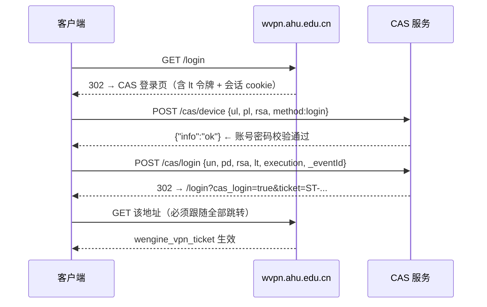
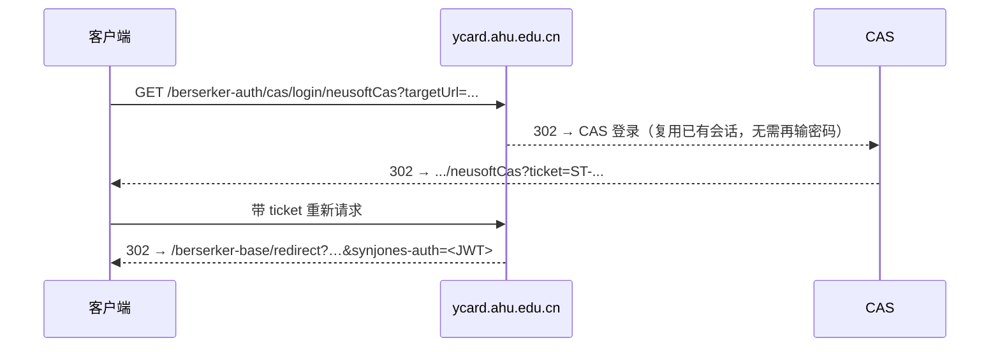

# 安徽大学校园卡二维码 — 协议逆向与 Android 实现

从安徽大学 WebVPN 门户获取**校园卡付款码**，并渲染成二维码。Python 参考实现与 Kotlin
Android 客户端均已**在真实账号上端到端验证**。Android 端为纯 Kotlin、**零第三方运行时依赖**，
通过 GitHub Actions 构建 APK（无需本地 Android Studio）。

---

## 1. 结论先行

**一码通不需要微信环境** —— 校园卡系统有一条**平行的官方通道**，走学校统一身份认证：

```
WebVPN 登录  →  CAS 会话  →  ycard.ahu.edu.cn 的 neusoftCas  →  synjones-auth JWT  →  取码
```

这条链路完全不经过微信。门户里那个「请在微信操作」页面是 `adwmh.ahu.edu.cn` 的微信专属
网关，服务端强制要求微信 OAuth 的 `code`，那条路无法绕过。

### 1.1 二维码内容：两种形态（重要）

实测发现**两个接口返回的取码内容不是同一种形态**：

| 来源 | 返回内容 | 形态 |
|---|---|---|
| `ycard` 的 `batchGetBarCodeGet`（本项目用） | 20 位纯数字 | 常被前端当**条形码（CODE128）**用 |
| `adwmh` 的 `/xzxcard/qrcode`（一码通页面用） | 20 位数字 **+ 94 字符 token** | 前端把 `val.slice(0,20)` 画条形码、**完整 val 画二维码** |

用微信扫描官方页面得到的真实二维码内容（解码两张不同时刻的截图）：

```
41194784288188343519 SPAEMBAGdcymoBAQE1ATEyAwC+x2oAAAAziQO6OPpKoqEDAGYDAAAADGfTGqgtAaf9PCtTuAifP77Ia7aBR5WSSivsCnXC
└── 20 位（每次刷新都变）  └── 94 字符 base64url，解出 70 字节服务端签名载荷
```

token 前缀 `SPAEMBA…` 在两次取样中高度重合，说明它是**服务端签发的带时间戳/签名的二进制
载荷**，无法从 20 位条码推导。

**`/xzxcard/qrcode` 需要 `adwmh` 的应用级会话**，未登录时 302 到 `/index/tologin`，而那是
**图形验证码登录页**（`username`/`pwd`/`imgcode`）。因此本项目**无法自动获取**那个 token ——
这是有意不做的：绕过图形验证码属于对抗服务端风控。

### 1.2 因此 App 提供两种模式

- **自动模式**：用 `batchGetBarCodeGet` 拿 20 位码并渲染。能满足只认 20 位格式的终端。
- **手动模式**：把官方页面上的完整内容粘贴进 App，按原样渲染（内容会校验字符集与前缀）。
  这是显示与官方完全一致二维码的可靠方式。

---

## 2. 完整认证链

### 2.1 WebVPN + CAS 登录

密码不是明文提交：页面把 `用户名+密码+lt` 用自带的 `strEnc(u+p+lt,'1','2','3')` 加密后放进
`rsa` 字段。这个 `strEnc` 是**自研非标准 DES**（每个 UTF-16 码元按 MSB-first 打平成 16 位，
不足 4 个码元补零），与标准 DES 不字节兼容，因此只能逐位复刻。



要点：

- `/cas/device` 是**必须**的前置调用：CAS 会校验该会话已通过 device 检查，才接受凭据表单。
- 票据跳转链要跟到底（`/login?cas_login=true` → `wengine-vpn-token-login`），否则隧道票据
  不生效，后续访问会被踢到 `/wengine-vpn/failed`。
- 新签发的票据偶尔被判「非法的Token」，属于服务端频率限制，退避重试即可（实现里带 4 次重试）。

### 2.2 校园卡 SSO（**绕开微信的关键**）



JWT 载荷（实测）：`{ iss, aud, sno:"<学号>", account:"<学号>", name, id, loginFrom:"app", uuid }`

### 2.3 取码

`berserker-*` 接口的鉴权方式是**请求头**（不依赖 cookie）：

```
synjones-auth: bearer <JWT>
synAccessSource: app          # GET 时同时并入 query
```

---

## 3. WebVPN 的 host hash 算法

隧道 URL 形如 `https://wvpn.ahu.edu.cn/https/<HASH>/<上游路径>`，`<HASH>` 是：

```
HASH = hex("wrdvpnisthebest!") + AES-CFB128(主机名)
       Key = IV = "wrdvpnisthebest!"，NoPadding
```

注意是 **CFB-128**（整块反馈），不是很多库默认的 CFB-8 —— 所以 Android 端手写了这个模式。

验证（`python tools/verify_host_crypt.py`，全部命中）：

| 主机 | 推导出的 hash |
|---|---|
| `open.weixin.qq.com` | `77726476706e69737468656265737421ffe7449269276d59660187e289446d36a8d6` |
| `res.wx.qq.com` | `77726476706e69737468656265737421e2f252d2302826416f468aa395` |
| `ycard.ahu.edu.cn` | `77726476706e69737468656265737421e9f4408e237e69586b468ca88d1b203b` |
| `adwmh.ahu.edu.cn` | `77726476706e69737468656265737421f1f356912f7e69586b468ca88d1b203b` |

> 这也解释了最初那三个链接：`.../plat/shouyeUser` 的 hash 其实指向 **ycard**（校园卡站），
> 而「一码通」链接的 hash 指向 **open.weixin.qq.com**（微信 OAuth）。

---

## 4. 仓库结构

```
ahu_client/                     Python 参考实现
  cas_des.py                    CAS 3DES 的逐位复刻
  webvpn.py                     WebVPN + CAS 登录、隧道请求
  vpn_apps.py                   host hash 算法
  des_tables.py                 从线上 des.js 提取的置换表（自动生成）
  cdp.py                        最小 Chrome DevTools 客户端（调试用）

android/                        Android 客户端（纯 Kotlin，零第三方运行时依赖）
  app/src/main/java/cn/edu/ahu/cardqr/
    crypto/CasDes.kt            3DES 移植（与 Python 共用同一批测试向量）
    crypto/WebVpnHostCrypt.kt   host hash（CFB-128 手写实现）
    net/HttpClient.kt           HttpURLConnection 封装，逐跳重新隧道
    data/AhuClient.kt           登录 → SSO → 取码
    data/SecureStore.kt         CredentialStore 接口 + Android Keystore/AES-GCM 实现
    qr/QrEncoder.kt             自写二维码编码器（纯计算，无 Android 依赖，可单测）
    qr/QrRenderer.kt            矩阵 → Bitmap
    MainActivity.kt             登录页 + 二维码页（含自动刷新）
  app/src/test/…                单元测试 + 由 Python 生成的参考夹具
  verify-stubs/                 为本地验证准备的 Android/org.json 桩
  verify-harness/VerifyMain.kt  本地验证程序（含真实端到端模式）

tools/                          逆向与验证脚本
  des_vectors.json              从线上 des.js 生成的 3DES 测试向量
  gen_des_vectors.js            重新生成上面的向量
  extract_des_tables.py         从 des.js 提取置换表
  qr_port_check.py              二维码编码器的 Python 镜像（用于比对）
  qr_decode_check.py            用 OpenCV 解码验证生成的二维码
  qr_kotlin_compare.py          Kotlin 与 Python 二维码矩阵逐模块比对
  verify_host_crypt.py          host hash 算法验证
  verify_login.py               登录链路验证
  verify-android.ps1            一键本地验证 Android 代码
  gen_qr_fixtures.js            生成 Kotlin 二维码测试夹具

.github/workflows/android.yml   CI：单元测试 + 构建 APK
```

---

## 5. 构建 APK（无需 Android Studio）

仓库：**https://github.com/xqNO5/ahu-campus-card**

推送到 GitHub 后，Actions 里的 **Build APK** 工作流会：

1. 跑 JVM 单元测试（DES 向量、host hash、二维码矩阵）；
2. 构建 debug APK；
3. 把 `app-debug.apk` 作为 artifact 上传。

**拿到 APK 的步骤**：打开 [Actions 页面](https://github.com/xqNO5/ahu-campus-card/actions)
→ 点最新一次成功的 **Build APK** → 页面底部 **Artifacts** → 下载
**ahu-campus-card-debug-apk**（约 0.8 MB，解压后是 `app-debug.apk`）→ 传到手机侧载安装。

本地没有 Android SDK 也能拿到 APK，这是本方案选择 GitHub Actions 的原因。

首次运行 App 需输入学号与密码；勾选「记住账号」时凭据用 **Android Keystore 中的
AES-256-GCM 密钥**加密后存 SharedPreferences（密钥不出安全硬件，拷走文件无法解密）。
`synjones-auth` JWT **不落盘**，仅在内存中（本来就能由 CAS 会话重新签发）。

---

## 6. 本地验证（不需要 Android SDK）

`tools/verify-android.ps1` 用桩类编译纯逻辑 Kotlin 并运行验证程序，需要 JDK 17 与
`.tools/` 下的 Kotlin 编译器 jar：

```powershell
# 依赖（Maven Central）
#   kotlin-compiler-embeddable-1.9.24.jar
#   kotlin-stdlib-1.9.24.jar
#   trove4j-1.0.20200330.jar
#   kotlin-daemon-embeddable-1.9.24.jar
#   kotlin-reflect-1.9.24.jar
#   annotations-24.0.1.jar
pwsh -File tools/verify-android.ps1
```

真实端到端（会真的登录学校系统，凭据从环境变量读取、不会打印）：

```powershell
cd android
$env:AHU_USER='<学号>'; $env:AHU_PASS='<密码>'
& "C:\Program Files\Java\jdk-17.0.5\bin\java.exe" -cp ".verify-build;..\.tools\kotlin-stdlib.jar" `
  "-Dahu.user=$env:AHU_USER" "-Dahu.pass=$env:AHU_PASS" `
  cn.edu.ahu.cardqr.verify.VerifyMain e2e
```

---

## 7. 验证情况

Python 侧：

| 验证项 | 方法 | 结果 |
|---|---|---|
| CAS 3DES | 10 组向量 vs 线上 `des.js` | 全部一致 |
| host hash | 4 个已知主机反解 + 回环 | 全部一致 |
| 登录 → SSO → 取码 | 真实账号端到端 | 通过，取到真实条码 |
| 二维码编码器 | 与 `qrcode` 库逐模块比对 | 41/44 完全一致，其余 3 例仅掩码选择不同 |
| 二维码可扫性 | 解码器回读 | 全部解出原文 |
| **真实官方载荷** | 对 114 字符真实内容编码 + 回读 | 编成 **version 6 / 纠错 L**，与官方一致；回读成功 |

Kotlin/Android 侧（`tools/verify-android.ps1`，**29/29 通过**）：

| 验证项 | 结果 |
|---|---|
| 3DES 10 组向量（与 Python 同一批） | 全部一致 |
| host hash 5 个主机（含回环） | 全部一致 |
| 隧道 URL 拼接 | 一致 |
| 二维码矩阵 4 个纠错级别 vs Python 参考 | 逐模块完全一致 |
| 定位图案 / 版本递增 / 超长拒绝 | 通过 |
| **真实端到端**：WebVPN 登录 → SSO JWT(312) → queryCard → 取码 → 渲染 | 通过，余额 8.70 元 |

### 7.1 关于掩码选择（已查清）

官方页面生成的两张二维码掩码分别是 4 和 6，而本项目对同一载荷选 3。这一点曾让我怀疑
编码器有问题，做了如下排查：

| 对照 | 掩码一致率（32 组载荷，均为字节模式） |
|---|---|
| 本项目 vs `qrcode` 库 | **31/32** |
| 本项目 vs `segno` | 10/32（`segno` 常把纯数字串压成 numeric 模式、版本不同，掩码不可直接比） |

结论：本项目的掩码选择与 `qrcode` 库一致，属于标准实现；官方页面用的是它自己的评分实现。
**掩码只是 8 种等效可选方案之一，不影响可扫性** —— 本项目生成的二维码经解码器回读全部成功。

本地编译过程中被编译器/验证程序抓到并修好的真实缺陷（这也是坚持本地验证的原因）：

1. Reed–Solomon 余数计算里 `Byte` 与 `Int` 混用（kotlinc 报类型错误）。
2. 单字符密钥 `"1"/"2"/"3"` 未补齐到 4 个 UTF-16 码元，导致密钥调度错误
   —— 表现为 4 字符输入正确、9 字符输入错误。
3. 二维码格式信息放置：横纵条带弄反、位序弄反，以及掩码评分时格式位的约定
   —— 与参考实现从 16 处差异收敛到 0。
4. `HttpURLConnection` 不会自动跟随 `/login` 的 302，且隧道的 `Location` 需要重新隧道
   —— 真实端到端跑出来的问题。

---

## 8. 注意事项

- **凭据不要提交进仓库。** 所有脚本已改为从 `AHU_USER` / `AHU_PASS` 环境变量读取；
  App 由用户在运行时输入。若发现残留，请先清理再分享。
- 付款码有时效（`expires`，实测 8640 秒），App 每 30 秒自动刷新一次，回到前台也会刷新。
- WebVPN 隧道内存在 `http-80` 路径，因此 `network_security_config.xml` 对 `ahu.edu.cn`
  放开了明文流量，其余域名保持默认禁止。
- 连续快速登录会触发「非法的Token」，属于服务端频率限制，非代码问题。
- 本项目仅供本人查询自己的校园卡使用；请勿用于他人账号。
